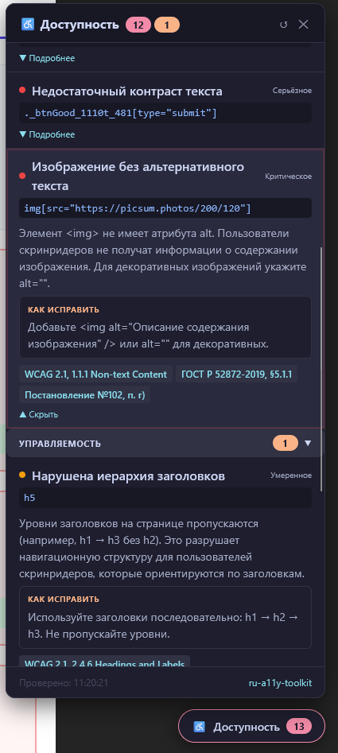
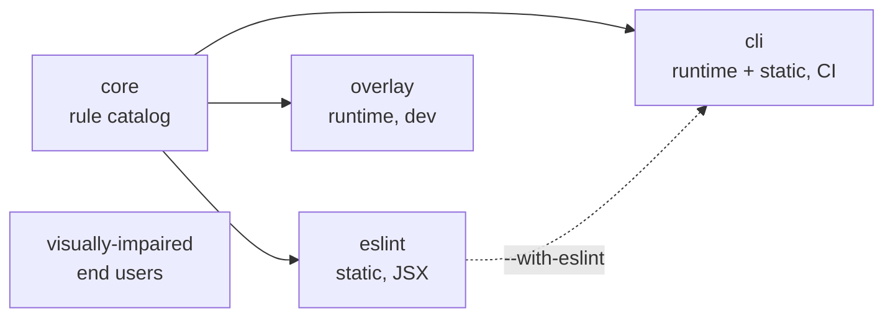

# ru-a11y-toolkit

[](https://github.com/biondohod/ru-a11y/actions/workflows/ci.yml)
[](https://www.npmjs.com/package/ru-a11y-toolkit)
[](./LICENSE)

**Web accessibility tooling for React apps that have to comply with Russian regulations.**
Lint rules, a development overlay, a CI auditor and an end-user "visually impaired" mode,
all driven by one rule catalog with Russian texts and references to
[GOST R 52872-2019](https://meganorm.ru/Data/547/54797.pdf) and
[Government Decree No. 102](http://publication.pravo.gov.ru/document/0001202602100010?index=1).

[Русская версия](./README.ru.md)



## Why

Accessibility tools such as `eslint-plugin-jsx-a11y` and axe-core speak English and cite WCAG.
Russian public sector sites are audited against GOST R 52872-2019 and, since March 2026,
against Decree No. 102, which phrase requirements differently and add their own
(200% zoom without horizontal scroll, the state language in confirmations, page titles
that describe the page purpose, and so on).

This toolkit closes that gap: every violation, wherever it is found, is reported in Russian
with the GOST clause, the Decree 102 item and the WCAG criterion, and comes with a concrete fix.

## Packages

| Package                                                             | What it does                                                                         |
| ------------------------------------------------------------------- | ------------------------------------------------------------------------------------ |
| [`ru-a11y-toolkit-core`](./packages/core)                           | Rule catalog: 115 rules with Russian texts, normative references and id aliases.     |
| [`ru-a11y-toolkit-eslint`](./packages/eslint-preset)                | ESLint plugin: 10 custom JSX rules, 26 translated jsx-a11y rules, 3 flat configs.    |
| [`ru-a11y-toolkit-overlay`](./packages/react-overlay)               | React dev overlay: axe-core plus 44 own DOM checks, highlights elements on the page. |
| [`ru-a11y-toolkit-cli`](./packages/cli)                             | CLI auditor: Puppeteer + axe-core + ESLint, console / JSON / HTML / JUnit reports.   |
| [`ru-a11y-toolkit-visually-impaired`](./packages/visually-impaired) | Readability mode for site visitors: font size, contrast schemes, spacing, focus.     |
| [`ru-a11y-toolkit`](./index.js)                                     | Umbrella package re-exporting all of the above.                                      |

## Architecture



- **One source of truth.** Rule titles, descriptions, fixes and references live only in
  `core`. ESLint messages, overlay cards and CLI reports are built from it, so the same
  problem reads the same everywhere. Tests in every package fail if the published rule
  counts drift from the catalog.
- **Shift left, then verify.** ESLint catches what is visible in JSX while you type, the
  overlay checks the real DOM in the browser, and the CLI audits deployed pages in CI.
- **Plain dependencies.** Packages depend only on `core` and their engine (ESLint, axe-core,
  Puppeteer). The overlay and the visually impaired mode have no runtime dependency on
  each other.

## Quick start

```bash
npm install --save-dev ru-a11y-toolkit
```

**Lint JSX** (`eslint.config.js`, ESLint 8.57+ flat config):

```js
const ruA11y = require('ru-a11y-toolkit-eslint');

module.exports = [ruA11y.configs['gost-aa']];
```

```text
src/App.jsx
  3:5  error  Отсутствует ссылка пропуска навигации (ГОСТ Р 52872-2019 §5.2.3.1, уровень A).
              Добавьте <a href="#main">Перейти к содержанию</a> в начало <body>.   ru-a11y/require-skip-link
```

**See violations in the browser** during development:

```tsx
import { RuA11yOverlay } from 'ru-a11y-toolkit-overlay';

{
  process.env.NODE_ENV === 'development' && <RuA11yOverlay preset="gost-aa" />;
}
```

**Audit pages in CI** and fail the build on new issues:

```bash
npx ru-a11y-cli https://example.com --format junit --output ./reports --max-issues 0
```

**Offer a readability mode** to visitors:

```tsx
import { VisuallyImpairedOverlay } from 'ru-a11y-toolkit-visually-impaired';
import 'ru-a11y-toolkit-visually-impaired/styles/visually-impaired.css';

<VisuallyImpairedOverlay />;
```

## Coverage

| Area                    | Checks | Engine                                          |
| ----------------------- | -----: | ----------------------------------------------- |
| Canonical rules in core |    115 | shared metadata                                 |
| ESLint                  |     36 | 10 custom + 26 jsx-a11y with rewritten messages |
| Overlay runtime         |    148 | 104 axe-core + 44 custom DOM checks             |

Automated checks find a large share of problems, not all of them. Keyboard flows and screen
reader behaviour still need manual testing.

## Development

Requires Node.js 20+.

```bash
git clone https://github.com/biondohod/ru-a11y.git
cd ru-a11y
npm install
npm run build      # core first, then the packages that depend on it
npm run check      # prettier, eslint, tsc and all test suites, as in CI
```

| Script              | Description                                |
| ------------------- | ------------------------------------------ |
| `npm test`          | Jest in every workspace                    |
| `npm run typecheck` | `tsc --noEmit` in every TypeScript package |
| `npm run lint`      | ESLint over the whole monorepo             |
| `npm run format`    | Prettier                                   |

```text
packages/
  core/               rule catalog (TypeScript)
    src/catalog/      axe-core and custom rule metadata
    src/registry.ts   lookups, alias index
  eslint-preset/      ESLint plugin (CommonJS, no build step)
    rules/            custom rules, rules/utils shared AST helpers
    rules/jsx-a11y/   translated jsx-a11y wrappers
    configs/          recommended, gost-aa, strict
  react-overlay/      dev overlay (React)
    src/rules/        runtime DOM checks grouped by topic
    src/ui/           panel components and style tokens
  cli/                auditor (Node)
    src/args/         declarative flag parser
    src/runner/       Puppeteer and ESLint runners
    src/report/       console, JSON, HTML, JUnit reporters
  visually-impaired/  end-user mode (React)
    src/model/ store/ dom/ hooks/ ui/
```

See [CONTRIBUTING.md](./CONTRIBUTING.md) for conventions and [CHANGELOG.md](./CHANGELOG.md)
for release notes.

## License

MIT © [biondohod](https://github.com/biondohod)
